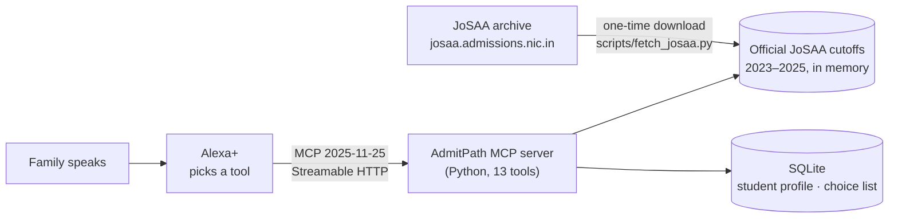

# AdmitPath

**"Alexa, which colleges can Riya get for computer science?"**

AdmitPath is an **Alexa+ add-on**: a self-hosted **MCP server** (spec 2025-11-25, Streamable HTTP) in Python that guides a family through **JoSAA engineering admissions** after JEE. It answers from **official JoSAA final-round opening and closing ranks for 2023 to 2025** (33,560 rows, 130 institutes: IITs, NITs, IIITs and other government institutes).

Every year families face a maze: over 100 institutes, hundreds of branches, quotas, categories, several rounds, and words like float, slide and freeze. Web "college predictors" turn a rank into a list. AdmitPath works by voice and guides the whole decision:

- **Knows the student.** Rank, category and category rank, gender and home state, so it applies the right quota (home-state or other-state at NITs), category seats and female-only seats automatically.
- **Safe / Target / Reach, with reasons.** Every answer says which seat it used, the past closing ranks, the trend and the expected cutoff.
- **Compares real choices.** "CSE at NIT Warangal or ECE at NIT Trichy?"
- **Builds the choice list** that families fill on the JoSAA portal, by voice.
- **Explains the process** in plain words: freeze, float, slide, quotas, seat acceptance, CSAB.
- **Says clearly when a college isn't in JoSAA** (IIIT Hyderabad, IIIT Delhi, DTU, BITS, VIT).

```
"Riya got 15,000 in JEE Main. She's OBC, rank 3,500, from Telangana."
→ "Saved Riya, JEE Main rank 15,000, OBC-NCL rank 3,500, female, from Telangana."

"Which NITs can she get for computer science?"
→ "Based on official JoSAA final-round closing ranks from 2023 to 2025 … Safe (29): NIT Delhi; NIT Calicut;
   NIT Kurukshetra, and 26 more. Target (2): NIT Allahabad; NIT Jaipur. Reach (2): NIT Rourkela …"

"CSE at NIT Warangal or ECE at NIT Trichy?"
→ "… ECE at NIT Tiruchirappalli: Target. On the other-state OBC-NCL girls-only seat, the closing rank was
   3,128 in 2025 … is the safer of the two."
```

## How it works



Answers come from local data in **16–43 ms**, well under Alexa+'s 500 ms limit.

### How Safe / Target / Reach is decided

1. **Pick the seats that apply:** home-state quota at NITs for students whose class 12 state matches the institute (other-state otherwise; Goa, J&K and Ladakh special quotas included), all-India elsewhere; OPEN seats with the overall rank and category seats with the category rank; gender-neutral seats, plus female-only seats for girls. IITs use JEE Advanced ranks, everything else JEE Main.
2. **Expected closing rank:** the 2025 final-round closing rank, adjusted by the median year-on-year change over 2023–2025 (clipped to ±15% so one odd year can't dominate).
3. **Ratio = student's rank ÷ expected closing rank:** Safe ≤ 0.85, Target ≤ 1.05, Reach ≤ 1.25. The best seat for the student counts.

These are estimates from past official data, not guarantees, and every answer shows the numbers behind it.

## The 13 tools

| Group | Tool | Example |
|---|---|---|
| Student | `set_student`, `get_student` | "Riya got 15,000, OBC, from Telangana" |
| Colleges | `predict_colleges` | "Which NITs can she get for CSE?" |
| | `check_option` | "Can she get CSE at NIT Warangal?" |
| | `compare_options` | "CSE at NIT Warangal or ECE at NIT Trichy?" |
| | `cutoff_trend` | "How has NIT Calicut CSE's cutoff changed?" |
| | `find_programs` | "What branches does NIT Goa have?" |
| Choice list | `add_choice`, `remove_choice`, `move_choice`, `read_choices` | "Put NIT Warangal CSE at the top" |
| Process | `explain_term`, `whats_next` | "What does float mean?" / "What happens after round 1?" |

## Run it

Python 3.10 or newer. Everything is free; no API keys.

```bash
python -m venv .venv
.venv\Scripts\activate            # macOS/Linux: source .venv/bin/activate
pip install -e ".[dev]"
python -m admitpath.server --port 8000
```

MCP endpoint: `http://localhost:8000/mcp`. Try every tool over MCP:

```bash
python scripts/smoke_test.py http://127.0.0.1:8000/mcp
```

Or use the [MCP Inspector](https://github.com/modelcontextprotocol/inspector) (Streamable HTTP, URL above): `npx @modelcontextprotocol/inspector`.

### Connect to Alexa+

Alexa+ needs a public HTTPS URL. A free Cloudflare quick tunnel works:

```bash
cloudflared tunnel --url http://127.0.0.1:8000
python -m admitpath.server --port 8000 --public-host your-name.trycloudflare.com
```

Then, with an Amazon Developer account and the Alexa+ MCP Toolkit (`alexa-ai` CLI, Preview):

```bash
alexa-ai configure
alexa-ai new mcp --name "AdmitPath" --locale en-US --mcp-server-url "https://your-name.trycloudflare.com/mcp"
alexa-ai deploy
```

Test in the Alexa+ Web Simulator.

## The data

`admitpath/data/josaa_orcr.csv` holds the official final-round opening and closing ranks for 2023, 2024 and 2025, downloaded from the public JoSAA archive. To refresh it (for example when a new year is published):

```bash
pip install -e ".[fetch]"
python scripts/fetch_josaa.py --years 2023 2024 2025
```

The script walks the archive form like a browser, one request per year and institute type, with pauses between requests. Preparatory-course ranks are kept in the file but not used for predictions. Institute home states (for home-state quota) are in `admitpath/home_states.py`, because JoSAA's tables don't list locations.

## Tests

```bash
pytest
```

28 tests cover the data, spoken-name matching (NITW, IIT kgp, triple IT Allahabad…), quota rules (home state, Goa, J&K), category and female seats, the trend calculation, a full conversation, and real MCP `initialize`, `tools/list` and `tools/call` requests.

## Limits

- Predictions are estimates from past cutoffs; seat counts and applicant numbers change every year.
- JoSAA only: IITs, NITs, IIITs and other centrally funded institutes. State counselling and private colleges aren't covered (AdmitPath says so).
- PwD predictions are approximate, and IIT PwD seats aren't predicted.
- Home state means the state where the student passed class 12, as JoSAA defines it.
- Alexa+ launched in the US first; Indian families may not have it yet.
- The server stores one family's student profiles locally; before real deployment, add Alexa+ account linking (OAuth 2.1 with PKCE).

## Privacy

Student details and choice lists are stored only in `data/admitpath.db` on the machine running the server. Nothing is sent to any other service.

## License

MIT. See [LICENSE](LICENSE). The cutoff data is public information published by JoSAA.
